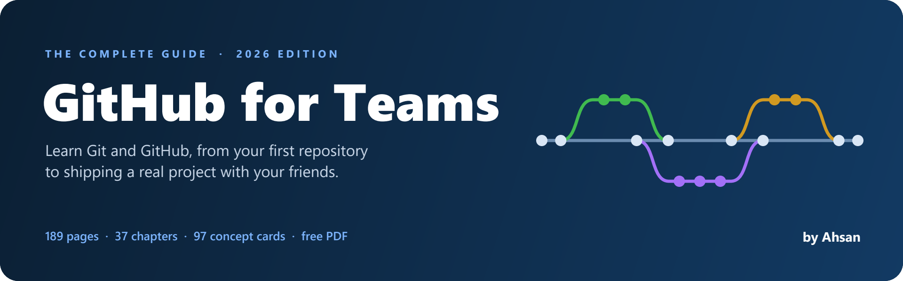
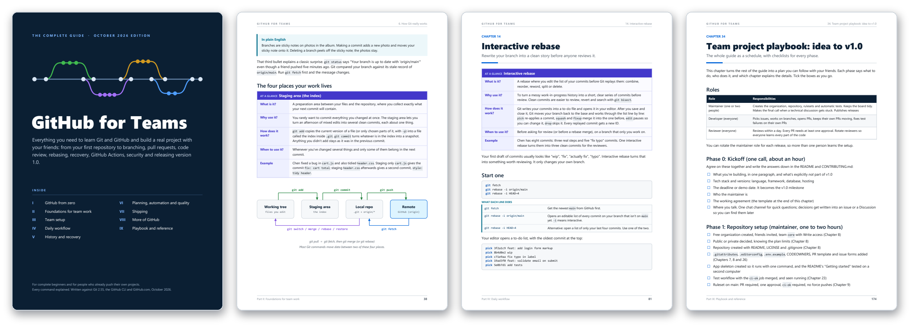
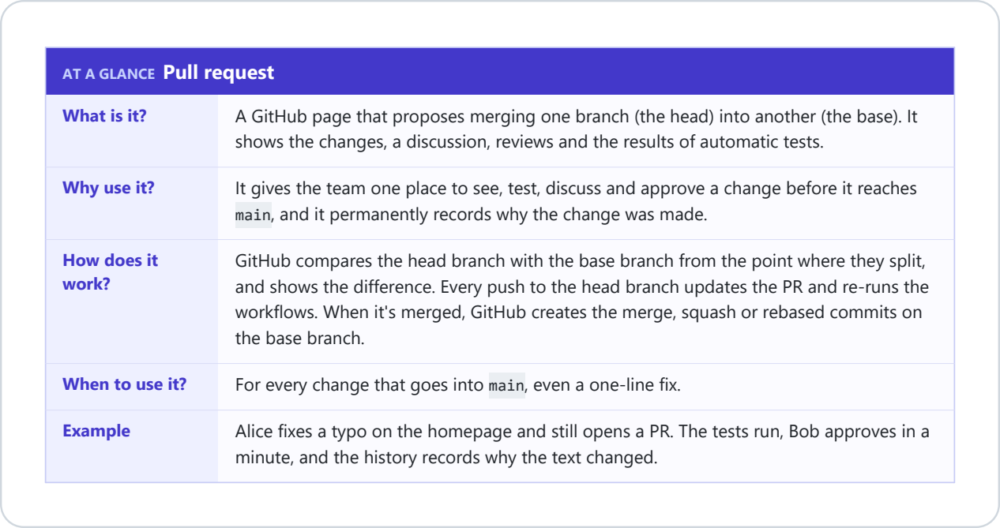
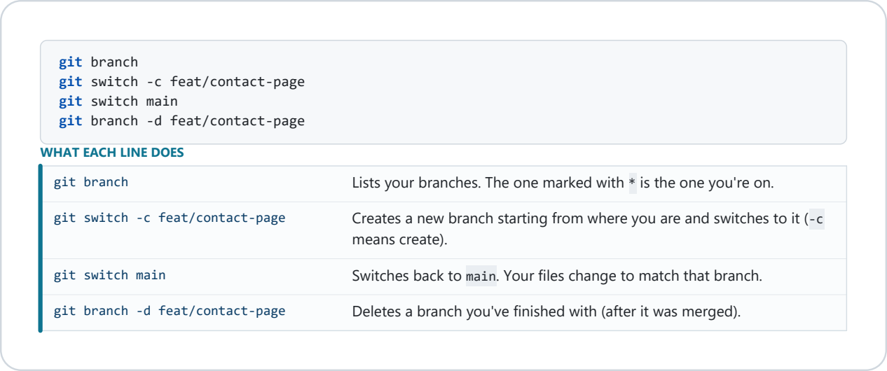
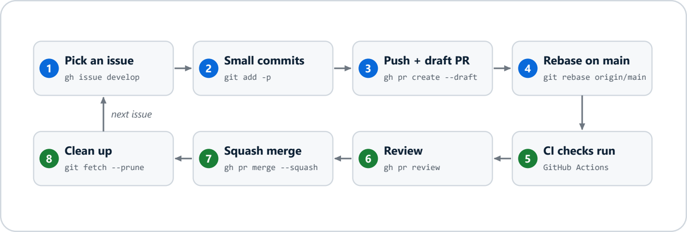
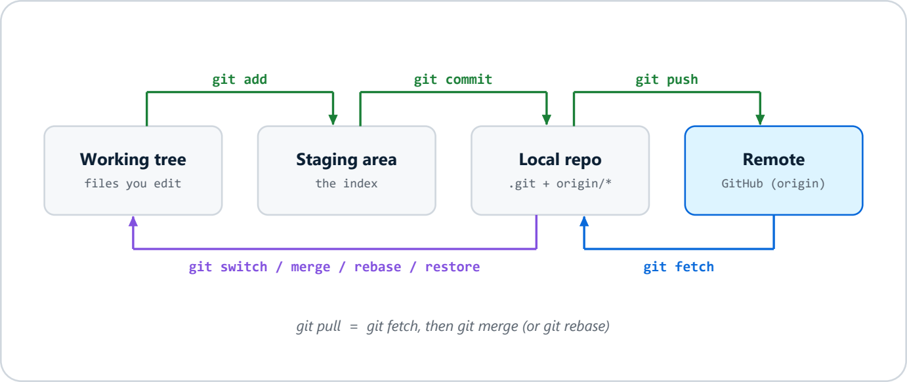

  

  
  &nbsp;
  

  
  
  
  
  
  
  

## 📖 About

A free, 189-page PDF guide to Git and GitHub. It starts from your very first repository and goes all the way to running a real project with your friends: branching, pull requests, code review, rebasing, fixing mistakes, GitHub Actions, security and releasing version 1.0.

Every command is explained line by line, and every feature gets a short card that answers *what it is, why you'd use it, how it works, when to use it,* and an example. The examples follow three friends, Alice, Bob and Chen, building a project together.

## 👀 Sneak peek

  

The cover &nbsp;·&nbsp; Ch. 6 How Git really works &nbsp;·&nbsp; Ch. 14 Interactive rebase &nbsp;·&nbsp; Ch. 34 Team project playbook

## 🎯 Who it's for

| | |
|---|---|
| 🌱 **New to Git and GitHub** | Part I starts from zero: what Git and GitHub are, creating an account, your first repository, the everyday commands, a tour of the website and writing in Markdown. |
| 💻 **Already pushing your own projects** | Parts II to VII cover what changes when three or four people share the same code: rulesets, pull requests, reviews, rebasing, conflicts, recovery and automation. |
| 👥 **Starting a team project** | Part IX is a step-by-step playbook from the first meeting to the v1.0 release, plus troubleshooting, a cheat sheet and practice drills. |

## ✨ How it explains things

**"At a glance" cards.** All 97 features start with a card like this one:

  

**"What each line does" boxes.** Every command block is followed by a plain-English explanation of each line:

  

And on top of that:

- 💡 **"In plain English" boxes** explain the hard ideas with everyday comparisons.
- 🗺️ **Diagrams** show how commits, branches, merges and forks fit together.
- 📚 **A glossary** of 74 terms, so no word is left unexplained.
- 🧪 **9 practice drills** to try with your team before it counts.

## 🔄 The team workflow in one picture

  

The daily loop from Chapter 11. Each step comes with the exact commands and what they do.

## 🧠 How Git moves your work

  

From Chapter 6. Once this picture clicks, most Git commands make sense.

## 🗂️ What's inside

| | Part | Chapters | Covers |
|:-:|---|:-:|---|
| 🌱 | **I. GitHub from zero** | 1–5 | What Git and GitHub are, your first repository, everyday commands, the GitHub website, Markdown |
| 🧱 | **II. Foundations for team work** | 6–7 | How Git stores your work, setting up your computer, SSH keys, signed commits |
| 🏗️ | **III. Team setup** | 8–10 | Creating the team repository, protecting `main` with rulesets, choosing a branching strategy |
| 🔁 | **IV. Daily workflow** | 11–18 | The branch, pull request, review and merge loop; good commits; merge, squash and rebase; interactive rebase; conflicts; code review; forks |
| 🛟 | **V. History and recovery** | 19–21 | Undoing almost anything, stash, cherry-pick, worktrees, searching history, `git bisect` |
| 🤖 | **VI. Planning, automation and quality** | 22–26 | Issues and Projects, GitHub Actions, deploying, automatic code checks, security |
| 🚀 | **VII. Shipping** | 27–28 | Versions, tags and releases, large files, dev containers and Codespaces |
| 🧩 | **VIII. More of GitHub** | 29–33 | Notifications and profiles, managing a repository, Discussions, wikis, gists, packages, GitHub Desktop, VS Code, Copilot, the API and webhooks |
| 📋 | **IX. Playbook and reference** | 34–37 | Team project playbook, troubleshooting common errors, cheat sheet, practice drills |

<b>📑 Full list of chapters</b>

 

1. What Git and GitHub are
2. Your first repository
3. Everyday Git commands
4. A tour of GitHub.com
5. Writing on GitHub: Markdown
6. How Git really works
7. Set up your computer for team work
8. Create the team repository
9. Protect main with rulesets
10. Choose a branching strategy
11. The team loop, step by step
12. Write commits your team can read
13. Merge, squash or rebase
14. Interactive rebase
15. Merge conflicts without panic
16. Pull requests that get merged
17. Code review as a team
18. Forks and upstream remotes
19. Undo anything
20. Juggle work: stash, cherry-pick, worktrees
21. Investigate history
22. Plan the work with Issues and Projects
23. GitHub Actions: CI that guards main
24. Deploy from main
25. Automate code quality
26. Security for small teams
27. Releases, tags and versions
28. Big files, big repos and shared environments
29. Notifications, profiles and the social side
30. Manage your repository
31. Discussions, wikis, gists and packages
32. Tools: GitHub Desktop, VS Code, mobile and Copilot
33. Connect GitHub to other tools: API, webhooks and apps
34. Team project playbook: idea to v1.0
35. Troubleshooting common errors
36. Cheat sheet
37. Practice drills

## 🧭 Where to start

| If you are... | Read |
|---|---|
| 🌱 New to Git and GitHub | Chapters 1 to 5, trying every step on your own computer. Then Chapters 7, 11 and 12 |
| 💻 Comfortable pushing your own projects | Chapters 6 and 7, then Parts III and IV |
| 👥 Starting a team project this week | Chapter 7 (everyone), Chapters 8 to 10 (whoever sets up the repository), Chapter 11 (everyone), then the playbook in Chapter 34 |
| 🆘 Stuck on an error | Chapter 35, then Chapter 19 |
| 🔎 Looking for one command | The cheat sheet in Chapter 36 |

## 🧰 Tools covered

  

  
  
  
  
  
  

Also: the GitHub CLI (`gh`), GitHub Desktop, Codespaces and dev containers, CodeQL code scanning, secret scanning, Git LFS, Projects, Discussions, wikis, gists, Packages, the REST API and webhooks.

## ⚙️ Versions

Written for Git 2.40 or newer (tested against Git 2.55), the GitHub CLI and GitHub.com as of October 2026. GitHub moves buttons around from time to time; if a setting isn't where the guide says, use the search box on the settings page or check [docs.github.com](https://docs.github.com).

## 💬 Feedback

Found a mistake, a broken step or something out of date? [Open an issue](https://github.com/ahsanauddry027/githubGuide_By_Ahsan/issues) and let me know.

If the guide helped you, a ⭐ on the repository helps other people find it.

## 👤 Author

  Made with ❤️ by <b>Ahsan</b>
    
  

